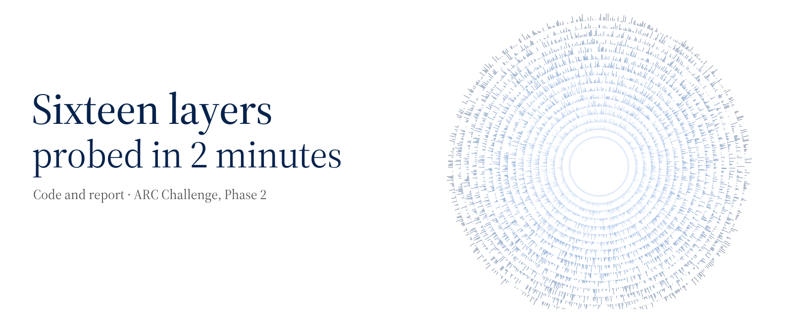

This repository holds our code, trained parameters and report for Phase 2 of the
[ARC White-Box Estimation Challenge 2026](https://www.aicrowd.com/challenges/arc-white-box-estimation-challenge-2026).
The task: estimate each neuron's average activity in a random deep network,
using its weights and a fixed budget of computation and time.

Our [final submission](https://www.aicrowd.com/challenges/arc-white-box-estimation-challenge-2026/submissions/337559)
scored **1.7453 × 10⁻⁹ adjusted** on the public leaderboard, with **100/100 networks completed**.

| Where | What you'll find |
| --- | --- |
| [Report](report.pdf) | The problem, the mathematics and the experiments, explained from the beginning. |
| [Solution](solution/) | The graded predictor and its trained parameters. |
| [Independent method](research/pc2/) | Two earlier predictors developed separately, with their original results. |
| [Evidence](evidence/) | Score tables, figure data and a script to check the recorded results. |
| [Report-to-code index](REPORT_MAP.md) | Where each part of the report appears in the release. |

[Run it locally](REPRODUCING.md) · [Exact results](RESULTS.json) · [Credits and data](CREDITS.md)

Our estimator builds on [Team 504aldo's cumulant-propagation code](https://github.com/504aldo/whest-p2-cumulant-k3).
The [MIT licence](LICENSE) applies to our work; the original third-party notices are retained.
